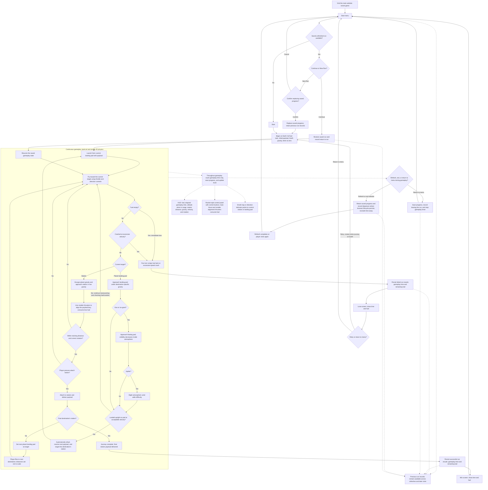

# Rocket game player flow

The game becomes the main website. Preserve the existing analytics and heatmap functionality. This document describes the player experience only; it does not change the website implementation.

## Complete player experience

## Destination order

Each destination supplies payload for its own station. After delivering that payload, the player manually flies to the next destination. The initial Earth launch begins with payload and a full tank; subsequent successful pad landings automatically provide refueling and the next payload.

```mermaid
flowchart LR
    earthStart["Earth: start"] --> moon["Moon"]
    moon --> venus["Venus"]
    venus --> mercury["Mercury"]
    mercury --> earthReturn["Earth: return"]
    earthReturn --> mars["Mars"]
    mars --> jupiter["Jupiter"]
    jupiter --> saturn["Saturn"]
    saturn --> uranus["Uranus"]
    uranus --> neptune["Neptune"]
    neptune --> lastDelivery["Deliver Neptune payload to its station"]
    lastDelivery --> complete["Journey complete"]
```

Gravity changes for each destination and decreases away from the planet. Exact gravity values, fuel/refueling quantities, landing velocity limits, and docking tolerances remain unspecified; the flow does not assign them. The final fuel rule is immediate failure at an empty tank, including during coasting.

Saved unfinished runs support Continue or New Run, with confirmation before replacement. Session time counts gameplay only. Leaving and returning are recorded separately from wins and losses. Progress must survive refreshes and later visits; reliable exit recording is subject to browser lifecycle limitations. Storage technology and exact save timing are not specified here.
