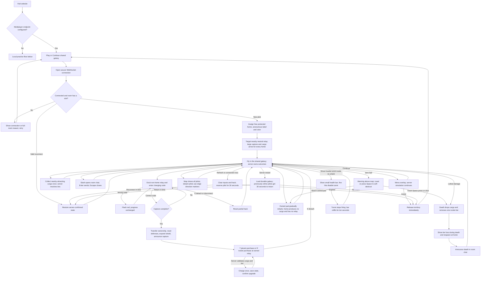
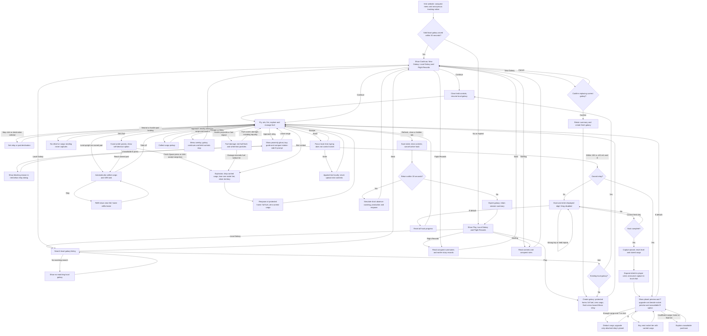

# Orbital Freight — runtime modes

A configured public server endpoint enables one shared galaxy. An empty endpoint
keeps the local practice experience below. The class-box service must be deployed
and its URL configured before multiplayer is live on Firebase.

Rocket tiers are sequential: fading acceleration/weapon improvement, twin gun,
fuel efficiency, then faster alternating barrels and bullet speed. Death floors
the tier at zero. Chat contents and reconnect credentials never enter analytics.
The server broadcasts public planet colors and map positions for all pilots, with only relevant full remote ship states. Room chat announces joins, disconnects, returns, departures, captures and deaths; messages remain transient.

---

# Orbital Freight — local conquest player flow

The homepage is a local, open-world conquest game. There are no other players or
bots in this version. Three scattered star systems share one galaxy with 24
planets; Earth is the pilot's protected home. The previous finite journey has
been replaced. This chart describes the implemented local experience.

## Continuous rules

- W burns at full thrust; S brakes only along the nose axis, preserving sideways drift without reversing motion. Mouse/trackpad steering follows the cursor
  with an acceleration-limited turn. Space fires; E attaches/detaches. Number
  keys 1–0 enter relay challenges. Double-tap W/A/S/D for rocket-relative dashes.
- The top-right map shows all planets, their ownership, home, stars, and target.
  There is no route progress bar or final win condition.
- All non-home planets start neutral. Hacking starts with digits 1–3; stronger
  defenses expand the digit pool and increase required presses. Detaching resets.
- Cargo is one resource. Owned planets produce it; owned-pad landings automatically
  collect it. Any owned relay can upgrade only its own planet.
- The upgrade sequence is bullet barrier → turret → outer field. Newly captured
  worlds have a weak field. Small fields gently repel hostile rockets; hard bullet
  barriers still allow rockets inside. Friendly shots ignore friendly barriers.
- Home cannot be captured and has a hard shield against hostile ships/shots.
- Turret shots are blocked around the relay refuge; player shots are not.
  The simulation supports these rules, but the local galaxy contains no opponents.
- Fuel reaching zero never ends a session. Coasting, gravity and shooting continue.
  Owned-pad refueling is free, faster when empty, and faster at home.
- Shots and fast impacts consume fuel; impact loss grows with speed. White
  particles show each hit. Equal damage leaves zero fuel; exceeding fuel kills.
- A fatal hit, star contact or confirmed self-destruct drops cargo and
  respawns at home. Planet ownership/upgrades survive death. Floating cargo expires.
- Live menus do not pause production or flight. Hidden tabs/refresh recover within
  30 seconds; later returns expire the local galaxy. Browser storage denial is shown.
- Starting a new galaxy requires confirmation and archives a summary. Earlier story
  flight records remain accessible and are not converted to conquest territory.

## Anonymous event logging

The menu discloses tracking and reports whether events are saved/pending. The
owner reads chronological rows at `/analytics.html`, with random visit IDs and
wall-clock/elapsed timestamps. Local development never uploads to production.

| Experience | Recorded events |
| --- | --- |
| Arrival, return, departure | pageView, pageReturn, pageLeave |
| First intentional action and choices | firstAction, click, screenView |
| Briefing and record views | briefingToggle, screenView |
| Enter, resume, replace, expire local galaxy | conquest lifecycle actions |
| Held flight and firing controls | controlPress/controlRelease; firing interval start/end |
| Map target choice | mapTarget, without coordinates or typed search |
| Docking approach, attach and detach | dockingChecklist, docked/detached |
| Hacking | start, progress milestones, cancellation and capture; no entered digits |
| Cargo | collection, drop and pickup amounts |
| Fuel service | refueling start/end |
| Upgrades | accepted/rejected outcome and tier |
| Fuel damage | bounded damage amount and remaining fuel |
| Destruction and respawn | death, respawn and self-destruct choices |
| Continued visible visit | bounded periodic heartbeat |

Events omit names, typed text, raw keys, aim coordinates, reconnect secrets and
persistent player identity. Delivery remains best effort if the browser closes
or the network blocks analytics. Historical rows remain readable.

Home planets have no relay or cargo production. New runs guide the player to the Moon relay above Earth. Chat is local-only until multiplayer exists.
