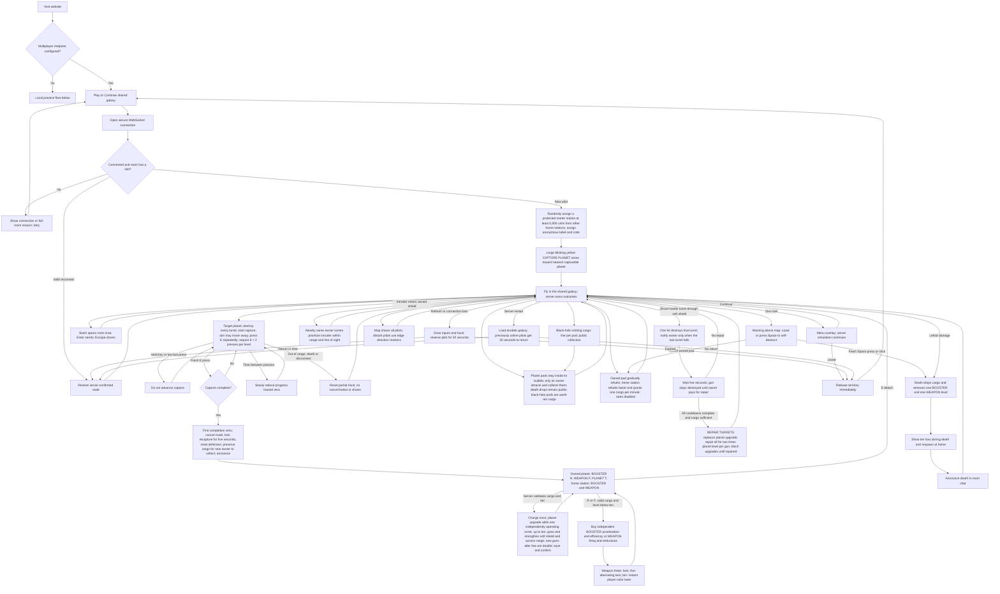

# Orbital Freight — runtime modes

A configured public server endpoint enables one shared galaxy. An empty endpoint
keeps the local practice experience below. The class-box service and its matching Firebase frontend are live.

BOOSTER and WEAPON advance independently to level ten. Both lose one level on death,
floored at zero; the death notice identifies both losses. Chat contents and reconnect
credentials never enter analytics.
The server broadcasts public planet colors and map positions for all pilots, with only relevant full remote ship states. Room chat announces joins, disconnects, returns, departures, captures and deaths; messages remain transient.

---

# Orbital Freight — local conquest player flow

The homepage is a local, open-world conquest game. There are no other players or
bots in this version. Three scattered star systems share one galaxy with 24
planets; the pilot starts at a protected station. The previous finite journey has
been replaced. This chart describes the implemented local experience.

```mermaid
flowchart TD
    visit[Visit website: conquest menu and anonymous tracking notice] --> saved{Valid local galaxy saved within 30 seconds?}
    saved -->|Yes| menu[Show Continue, New Galaxy, Local Galaxy and Flight Records]
    saved -->|No or expired| fresh[Show Play, Local Galaxy and Flight Records]
    fresh -->|Play| start[Create galaxy: protected starter station, full fuel, zero cargo; show CAPTURE PLANET arrow]
    menu -->|Continue| resume[Clear held controls; resume local galaxy]
    menu -->|New Galaxy| confirm{Confirm replacing current galaxy?}
    confirm -->|Cancel| menu
    confirm -->|Confirm| archive[Retain summary and create fresh galaxy]
    archive --> start
    fresh -->|Local Galaxy| directory[Search local galaxy listing]
    menu -->|Local Galaxy| directory
    directory -->|No matching search| empty[Show no matching local galaxy]
    empty --> directory
    directory -->|Join| join{Existing local galaxy?}
    join -->|Yes| resume
    join -->|No| start
    directory -->|Back| menu
    fresh -->|Flight Records| records[Read conquest summaries and earlier story records]
    menu -->|Flight Records| records
    records -->|Back| menu
    menu -->|Briefing| briefing[Read controls and conquest rules]
    fresh -->|Briefing| briefing
    briefing --> menu
    start --> flight[Fly, aim, fire, explore and manage fuel]
    resume --> flight
    flight -->|Map click or destination selector| target[Set relay or pad destination]
    target --> flight
    flight -->|Approach relay, planet, star or black hole| checks[Show target range and E interaction prompt]
    checks -->|Unavailable E press| dockError[Show blocking reason in red below relay dialog]
    dockError --> checks
    checks -->|Leave range| flight
    checks -->|Within range and E| attach{Target owned or home station?}
    attach -->|Neutral or hostile territory| hack[Press E repeatedly to capture; cursor may move away]
    hack -->|Held E or too-fast press| hack
    hack -->|Fresh E press| progress{Hack complete?}
    progress -->|No; rival progress continues independently| hack
    progress -->|Yes; first finisher wins| capture[Capture planet, star or black hole; reset upgrades and preserve cargo for collection]
    capture --> captureEffect[Start at defense level 1; add turret and colored shield; repel enemies for five seconds; lock recapture for five seconds]
    captureEffect --> upgrade[Planet offers BOOSTER R, WEAPON F and PLANET T; home offers BOOSTER and WEAPON]
    attach -->|Yes| upgrade
    hack -->|Move out of range, die or disconnect| cancel[Reset that pilot's hack progress]
    cancel --> flight
    enemyApproach[Enemy rocket approaches owned territory] --> shield[Shield slows enemy rockets and hostile bullets; dotted ring marks turret range]
    shield --> turrets{Any live turrets?}
    turrets -->|Yes| destroy[Enemy shoots turret; show debris burst and red pulse on remaining guns]
    destroy --> turrets
    turrets -->|All down| hack
    hack -->|Another pilot finishes first| lostRace[Close losing capture panel; apply five-second recapture lock]
    lostRace --> flight
    upgrade -->|Enough cargo and T or click| purchase[Deduct cargo; upgrade planet up to ten only when all guns are repaired]
    purchase --> upgrade
    upgrade -->|R| rocketPurchase[Buy BOOSTER level with carried cargo]
    rocketPurchase --> upgrade
    upgrade -->|F| weaponPurchase[Buy WEAPON level with carried cargo]
    weaponPurchase --> upgrade
    upgrade -->|Destroyed turrets| repair[Replace PLANET with REPAIR TURRETS; require cooldowns and total cargo]
    repair --> upgrade
    upgrade -->|Insufficient cargo, home or final tier| unavailable[Explain unavailable purchase]
    unavailable --> upgrade
    upgrade -->|E detach| flight
    flight -->|Land upright on owned pad| service[Refill tank faster; collect cargo by touching orbiting pods]
    service -->|Stay| refill[Refill slows near full; home refills faster]
    refill --> service
    service -->|Take off| flight
    flight -->|Neutral or hostile pad landing| noservice[No refuel or cargo; landing never captures]
    noservice --> flight
    flight -->|Zero fuel| emptyfuel[Coast under gravity; show self-destruct option]
    emptyfuel -->|Reach owned pad| service
    emptyfuel -->|Fresh Space press or click: accept cargo loss| death[Explosion; drop carried cargo; lose one BOOSTER and WEAPON level; retain territory]
    flight -->|Hostile projectile or fast impact| damage[Fuel damage; red hull flash and white leak particles]
    damage -->|Damage exceeds fuel before hit| death
    damage -->|Fuel covers damage, including equality| flight
    flight -->|Star or black-hole contact| death
    death --> respawn[Respawn at protected home: full fuel, zero carried cargo]
    respawn --> flight
    flight -->|Slash| chat[Focus local chat; typing does not control rocket]
    chat -->|Enter| sendChat[Append text locally; never upload chat contents]
    sendChat --> flight
    chat -->|Escape| flight
    flight -->|Approach nearby attracting cargo and touch it| pickup[Collect cargo pickup]
    pickup --> flight
    flight -->|Escape or Menu| livemenu[Menu overlay; galaxy continues and held controls stop]
    livemenu --> menu
    menu -->|Continue| flight
    flight -->|Refresh, close or hidden tab| leave[Save state; clear controls; cancel active hack]
    leave --> reconnect{Return within 30 seconds?}
    reconnect -->|Yes| recover[Simulate short absence: coasting, production and respawn]
    recover --> menu
    reconnect -->|No| expire[Expire galaxy; retain session summary]
    expire --> fresh
```

## Continuous rules

- W burns at full thrust; S brakes the full velocity vector until stopped, with one brake plume pointing opposite movement regardless of heading. Mouse/trackpad steering follows the cursor
  with an acceleration-limited turn. Space fires; E opens services or initiates capture, then repeated E presses advance capture. Held E does not count. R buys BOOSTER, F buys WEAPON and T buys PLANET or repairs in a shop.
- The top-right map shows all planets, their ownership, home, stars, and target.
  There is no route progress bar or final win condition.
- Planets start neutral. Capture uses 8 + 2 times planet level fresh E presses and loses 0.65 press-equivalents per second when idle. Leaving the shield range resets progress.
- Cargo is one resource. Owned planets produce it; only the current owner can collect planet pods. Capture preserves cargo without crediting it directly. Black-hole pods and death drops are public.
- Every planet upgrade adds one turret and grows/strengthens its soft field, up to level ten. Guns are evenly spaced. Hostile bullets are slowed and deflected but can always penetrate; friendly shots ignore the field. Destroyed turrets become repairable after five seconds for two times the current level in cargo.
- Home cannot be captured and has a hard shield against hostile ships/shots.
- Turret shots are blocked around the relay refuge; player shots are not.
  The simulation supports these rules, but the local galaxy contains no opponents.
- Fuel reaching zero never ends a session. Coasting, gravity and shooting continue.
  Owned-pad refueling is free, faster when empty, and faster at home.
- Shots and fast impacts consume fuel; impact loss grows with speed. White
  particles show each hit. Equal damage leaves zero fuel; exceeding fuel kills.
- A fatal hit, star contact or confirmed self-destruct drops cargo and
  respawns at home. Planet ownership/upgrades survive death. Floating cargo expires.
- Live menus do not pause production or flight. Hidden tabs/refresh recover within
  30 seconds; later returns expire the local galaxy. Browser storage denial is shown.
- Starting a new galaxy requires confirmation and archives a summary. Earlier story
  flight records remain accessible and are not converted to conquest territory.

## Anonymous event logging

The menu discloses tracking and reports whether events are saved/pending. The
owner reads chronological rows at `/analytics.html`, with random visit IDs and
wall-clock/elapsed timestamps. Local development never uploads to production.

| Experience | Recorded events |
| --- | --- |
| Arrival, return, departure | pageView, pageReturn, pageLeave |
| First intentional action and choices | firstAction, click, screenView |
| Briefing and record views | briefingToggle, screenView |
| Enter, resume, replace, expire local galaxy | conquest lifecycle actions |
| Held flight and firing controls | controlPress/controlRelease; firing interval start/end |
| Map target choice | mapTarget, without coordinates or typed search |
| Docking approach, attach and detach | dockingChecklist, docked/detached |
| Hacking | start, progress milestones, cancellation and capture; no entered digits |
| Cargo | collection, drop and pickup amounts |
| Fuel service | refueling start/end |
| Upgrades | accepted/rejected outcome and tier |
| Fuel damage | bounded damage amount and remaining fuel |
| Destruction and respawn | death, respawn and self-destruct choices |
| Continued visible visit | bounded periodic heartbeat |

Events omit names, typed text, raw keys, aim coordinates, reconnect secrets and
persistent player identity. Delivery remains best effort if the browser closes
or the network blocks analytics. Historical rows remain readable.

Home planets have no relay or cargo production. New runs guide the player to the Moon relay above Earth. Chat is local-only until multiplayer exists.
