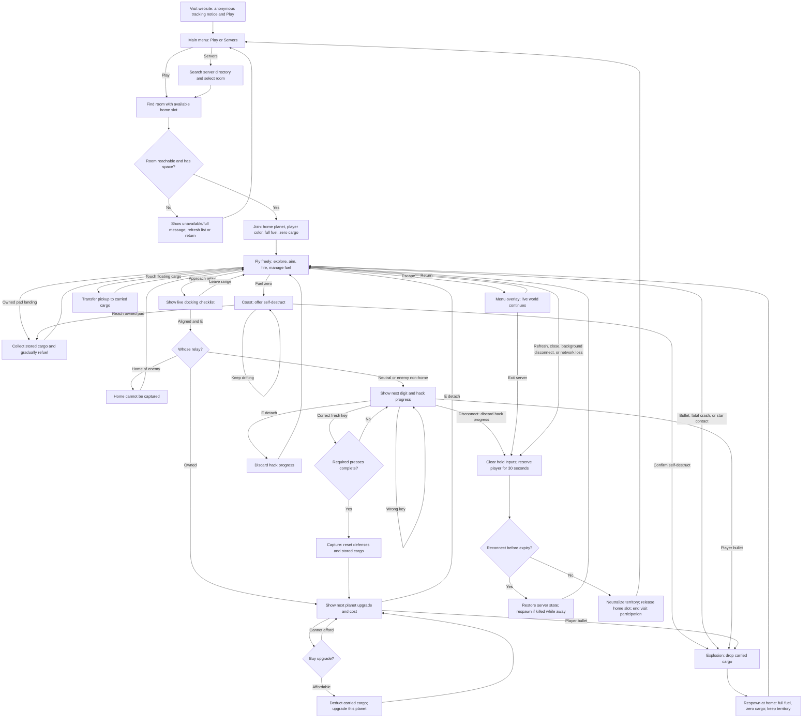

# Orbital Freight multiplayer implementation draft

> Historical draft. Current approved behavior is in PLAN.md; implementation and
> class-box setup are documented in server/README.md. Older controls, combat, and
> resource rules below are preserved as planning history.

Status: proposed implementation, November 18, 2026. Gameplay has not been changed.
This document translates the multiplayer discussion into a buildable first version.
The existing FLOW.md describes the published game until multiplayer replaces it.
Proposed defaults below are tuning assumptions, not additional agreed features.

## Player and experience

A visitor wanting a short, competitive space game presses Play and immediately
joins strangers. They start on their own protected home planet with a full fuel
tank, no cargo, and a basic armed rocket. The first objective is to fly to a neutral
relay, learn hacking without planetary defenses, capture its planet, land to
collect cargo/refuel, then spend cargo at an owned relay to improve that planet.
Other players compete for the same planets and can destroy rockets in one hit.

The repeatable loop is explore → hack → land/collect/refuel → upgrade → defend or
capture again. There is no prescribed planet sequence, final station, or victory
screen. Territory lasts only while the player remains in that server, including
the 30-second reconnect allowance. Death returns the player to their home.

## Agreed first-version scope

- Public Play matchmaking, plus a server directory/search to find friends.
- One galaxy per game room, initially three systems scattered across a 2D plane.
- Each system has a star, planets, and one relay per planet. Contact with a star kills.
- Continuous flight, arcade distances, existing gravity differences, main/RCS fuel use,
  rotation, upright landing, docking alignment, gentle impacts, and crash effects.
- A unique player color, protected home, cargo, limited fuel, and one basic weapon.
- All non-home planets require a relay hack to capture, including neutral planets.
- Cargo production, automatic collection, fuel refill, and planet upgrades.
- Top-right galaxy map, visible ownership, and limited enemy visibility.
- No rocket upgrades yet, no extra turret tiers beyond the initial defense sequence,
  no accounts, no permanent progression, and no automatic galaxy expansion yet.

## Controls

| Input | Action |
| --- | --- |
| Hold W | Main engine at full output; release to coast |
| A / D or left / right | Rotate |
| I / J / K / L | Rocket-local translation thrusters |
| Mouse | Aim the weapon independently of rocket rotation |
| Hold Space | Fire at the weapon's fixed cooldown; cannot fire while docked |
| E | Attach to an eligible relay, or detach if attached |
| 1–0 | Enter the currently displayed hacking digit |
| Escape | Open the menu; multiplayer simulation continues |

Equivalent onscreen flight controls remain. Provide a Fire button and one large
onscreen digit button for touch; exact touch aiming needs a small implementation
choice. Server browser, upgrade, and self-destruct choices are ordinary buttons.

## World and ownership

Assign an available planet as each new player's home. Home cannot be hacked and
has a small hard shield that blocks enemy rockets and enemy bullets. Friendly
rockets and friendly shots pass through, as requested. A player respawns there
with full fuel and zero carried cargo after death, retaining their other planets.

All other planets begin neutral. Their relays remain available to approach and
hack. Finishing a hack transfers ownership, resets that planet's upgrades to its
basic captured state, and clears stored cargo to zero. Landing alone never captures.

Every captured non-home planet has a small owner-colored field that gently pushes
hostile rockets away. It does not create a hard rocket boundary: an enemy can get
inside or land, but cannot refuel, collect production, or upgrade there. Friendly
rockets are unaffected. Bullet protection is independent of rocket repulsion.

## Cargo and fuel

Planets produce one resource, cargo, over time. The server tracks each planet's
stored cargo separately from each rocket's carried cargo. An owned-pad landing
automatically transfers available cargo to the rocket. Production/collection is
continuous while landed; no repeated landing exploit is possible because actual
stored cargo is removed on transfer.

At any owned relay, the player can spend carried cargo to upgrade only that
relay's planet. Display one button describing the next upgrade and its cost;
disable it when cargo is insufficient or the current prototype tier is complete.

Refuel only while correctly landed on an owned pad. Refilling is free of cargo
cost and decelerates as the tank fills. Home refills faster; upgrades do not
change refill speed. Players can leave at any point.

Proposed implementation: refill rate = baseRate × max(0.15, 1 − fuelFraction).
Use a higher baseRate for home, cap at full, and snap the last small fraction to
100%. This avoids an endlessly approaching full tank. Rates remain playtest tuning.

At zero fuel, the rocket coasts and gravity still applies. Thrust and rotation
consume no nonexistent fuel and cannot operate. Shooting remains available.
A compact prompt offers self-destruct; it does not pause the world. Reaching an
owned pad without fuel still allows refueling. Self-destruct uses the death flow.

Death drops carried cargo as a floating, collectible pickup. Any rocket may
collect it; the destroyed player can recover it after respawning. Planets and
planet upgrades remain owned on death. Future rocket upgrades may lose one level
on death, but that system is deferred.

## Hacking

1. Approach a neutral or enemy non-home relay and meet the existing docking checks.
2. Press E to attach. Begin a server-issued digit challenge.
3. Show one stable, large digit and a progress bar. Correct fresh presses advance
   progress and issue a new digit. Wrong presses leave progress unchanged.
4. Neutral/basic challenges use 1–3. Higher planet levels gradually broaden the
   pool toward all ten digits, 0–9, and modestly increase required successful presses.
5. Holding a key does not repeat valid presses. The server caps accepted input rate
   and rejects stale/replayed challenge responses.
6. Detaching, dying, or losing the connection cancels the hack and resets progress.
7. Completion atomically captures the planet and clears its old upgrades/stock.

Players cannot shoot while docked. Other players can shoot the hacker. A visible
relay refuge blocks turret projectiles near the receiver, including before
attachment, but does not stop player bullets. Turrets should target attackers
outside that refuge instead of wasting shots into it. The refuge does not block
rockets or make anyone immune to player fire.

## Initial defense sequence

| Level | State / next purchase |
| --- | --- |
| 0: newly captured | Small field slows enemy bullets and gently repels rockets |
| 1 | Small bullet barrier stops enemy shots crossing it |
| 2 | One turret slowly fires at hostile rockets approaching the planet/relay |
| 3 | Large outer field encloses planet and relay, gently repelling rockets/bullets |

The large field is never a hard boundary. It supplements the smaller bullet
barrier. Friendly shots pass through both. Enemy rockets can cross a bullet
barrier and fire from inside it. The hard home shield is a distinct exception.

Extra turrets, improved turrets, additional defense tiers, and rocket upgrades
are deferred. Costs, bullet slowdown, turret cadence, and force strengths are
configuration values to tune. Home uses its hard shield rather than the ordinary
small-shield progression; first-version home upgrade availability is an assumption
listed below.

## Combat and visibility

One basic projectile hit destroys a rocket. Standard weapons never directly
damage/capture planets. Aim toward the mouse; the server checks firing cooldown,
rocket state, projectile origin, travel, lifetime, shield crossings, and hits.
Projectiles must use swept collision checks so fast shots cannot pass through
rockets or shield boundaries between simulation steps.

Nearby enemies are visible. Firing temporarily reveals an enemy at greater range
on the map; exact duration/radius are tuning. Do not deliver hidden enemies' full
live states to every client. All planets and their owner colors remain on the
map, including home markers, the player's position, and system/star locations.
The map replaces route progress and occupies the top-right corner; Menu moves
adjacent to it without covering the map. No linear delivery counter remains.

## Full player flow

The chart describes the proposed product rules, not a claim that these screens
already exist. Check it against the final implemented interface before release.

## Simplest technical implementation

Keep the existing static frontend and pixel-art canvas renderer. Host a separate
long-running game process on the user's physical server and connect browsers
through secure WebSockets. Keep the current Firebase static hosting and owner
analytics; do not use Firestore as a high-frequency game-state transport.

One process can initially manage several independent rooms plus a read-only room
directory. Start with one listed room. Play chooses a non-full room; the directory
shows searchable room name/ID, online occupancy, capacity, and availability.
Do not add chat, friend accounts, or a social graph.

The server owns physics, fuel, cargo, ownership, docking, hacking, upgrades,
projectiles, death, and reconnect expiry. Clients send bounded input changes and
actions, never authoritative positions, hit claims, resource amounts, or ownership.
Reuse/refactor the existing deterministic physics rather than duplicating its rules.

A fixed simulation step and lower-rate snapshots let clients interpolate remote
rockets and predict their own movement, correcting against server state. Proposed
starting rates are 60 simulation steps/sec and 15–20 snapshots/sec, to be profiled
on the provided server. Bound catch-up work, message sizes/rates, projectile counts,
and expired cargo pickups. Reject non-finite/out-of-range inputs.

Issue an opaque, short-lived reconnect credential per player/room. Store it locally
for refresh recovery, never in public URLs or analytics. Only one socket controls
a player at a time. Disconnect clears thrust/fire; its rocket remains vulnerable.
An expired credential cannot recover territory. Server restart resets all rooms;
there is no database-backed universe persistence in this prototype.

Server sends a shared world definition on join, followed by relevant snapshots and
reliable outcome messages. Reconnect receives a fresh snapshot, not client-saved
world progress. Actions use IDs/sequence checks to prevent duplicate upgrade,
cargo transfer, hack completion, and death processing.

## Suggested file responsibilities

- Existing rocketPhysics.mjs: preserve reusable gravity, movement, docking, and collision helpers.
- New shared multiplayer rules module: world definitions, fuel/cargo rules, planet tiers, constants.
- New server directory: room simulation, socket protocol, directory endpoint, launch configuration.
- New frontend connection module: input messages, reconnect, snapshots, local prediction.
- Existing rocketApp.mjs: multiplayer lifecycle, minimal menus, interaction/hack/upgrade UI.
- Existing rocketRenderer.mjs: other rockets, shots, shields, turrets, cargo, stars, galaxy map.
- Existing index.html/style.css: existing cockpit adapted to cargo, map, and multiplayer state.
- FLOW.md: replace with reviewed multiplayer chart when the experience is implemented.
- Existing logging modules/rules/dashboard: extend product allowlists for the new flow.

Exact server framework/dependency choices await server details and implementation
approval. Use environment configuration for allowed frontend origins, listener
port, room limits, and development/production modes. Keep secrets off the frontend.

## Tracking rails

Keep random visit IDs, ordered timestamps, remote readable logs, and the initial
tracking notice. Record arrival, Play, server search/open/join selection and result,
spawn, control press/release, menu choices, docking attempts/results, hack start/
progress milestones/cancel/complete, capture, cargo collection/drop/pickup,
refuel start/end, upgrade purchase/result, firing start/end, death, respawn,
self-destruct choice, disconnection, rejoin, exit, and ownership release.

Do not upload every simulation tick, projectile, mouse movement, or hacking key.
Aggregate held fire and hack milestones; record counts/outcomes rather than raw
keyboard digits, entered search text, player identities, or reconnect credentials.
Economic/combat results come from server-confirmed outcomes. Gameplay validation
must not depend on analytics being available. Keep the private dashboard readable
for the new event labels and preserve old historical rows.

The public footer was removed by request. Put log delivery/pending status in the
menu so tracking can still be verified without restoring bottom-bar clutter.

## Build order and acceptance

1. Extract shared rules and build a small, scattered three-system world. Keep the
   existing published game available until the replacement is playable.
2. Add room server, Play/join, home allocation, two connected ships, controls,
   authoritative movement, remote interpolation, and reconnect/expiry.
3. Add neutral relay hacking, ownership colors, cargo production/collection,
   decelerating owned-pad refuel, cargo pickups, and upgrade purchase transactions.
4. Add aimed fire, death/respawn, shield/projectile interactions, relay turret
   refuge, turret and outer-field progression, star collision, and self-destruct.
5. Add top-right map, limited visibility, directory/search, compact game dialogs,
   updated tracking and private log labels. Remove finite-route UI and controls.
6. Playtest two browsers simultaneously, then several clients. Verify full loops,
   disconnect races, captures, upgrade spending, dropped cargo, safe spawn, and
   fair turret approach. Run meaningful shared-rule/protocol tests plus browser
   checks; update outdated singleplayer tests as behavior is intentionally replaced.
7. Configure the provided physical server, secure WebSockets, process restart,
   allowed origins, and static frontend endpoint. Deploy frontend/server together
   only after the complete loop works and rollback is concrete.

Done means two real players can join from separate devices, contest a planet,
collect/refuel/upgrade, fight and respawn, reconnect within 30 seconds, and see
correct ownership on the map. A third player can find their room in the directory.
The owner can read the resulting event flow remotely without visitor identity.

## Proposed defaults and unresolved tuning

These are implementation assumptions to review, not settled gameplay additions:

- Fixed galaxy layout shared within each room; proposed 24 planets (8 per system)
  and at most 8 simultaneous players, with fair home spacing and no growth yet.
- Grant an available neutral planet as home; if none is suitable, room is full.
- Preserve varied gravity, but choose home candidates that can launch with the
  base main engine. Planets do not orbit for this prototype.
- Home already has its special shield and fast fuel service; disable home defense
  purchases initially because the normal shield sequence does not apply to it.
- One rocket may occupy a relay receiver at a time. No extra capture contest UI.
- Hack difficulty depends on defense level, caps at the prototype's final tier,
  and uses one displayed digit at a time without a response timeout.
- Successful hackers stay docked and see their now-owned relay's upgrade action.
- A missed hack key does nothing; detaching/death/disconnection resets progress.
- Finite cargo stock and pickup expiry/caps prevent abandoned resources accumulating
  forever; values require playtesting. No cargo spending for bullets or refueling.
- Server decides pickup ties and simultaneous hits/captures in a stable tick order.
- Keep present crash tolerance rules; lethal crashes join the multiplayer death flow.
- Non-gameplay time in a menu does not extend personal active-input time, but the
  multiplayer world, fuel service, production, and enemy attacks keep running.
- Thirty seconds applies to refresh/network loss and leaving; returning within the
  window resumes. Expiry neutralizes all owned planets and clears their stock/tiers.
- A disconnected rocket can die and drop cargo. The server keeps its respawn state
  until reconnect/expiry, preventing a temporary disconnection from granting safety.
- Planet positions/ownership are public map data. Nearby visibility and shooting
  reveal timing need playtesting; exact hidden rocket positions stay server-side.
- Aim/fire/touch details, camera scale for the larger world, costs, resource rates,
  bullet speed, fire cadence, force strengths, and hacking lengths remain tuning.

## Server details needed before deployment

Operating system, how to connect/administer it, available CPU/RAM, domain/subdomain,
public connectivity/port forwarding or existing reverse proxy, and the preferred
way to keep the game process running. Supply credentials through the appropriate
secure access mechanism, not prompts.md or committed configuration.
